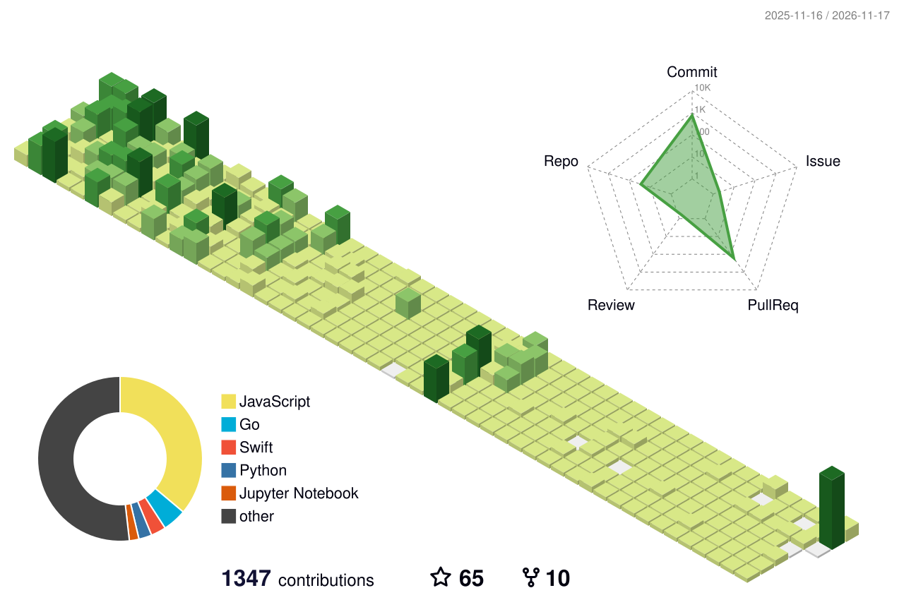

<!--   my-header-img -->

    
    
    
    
       

<!--   my-ticker -->

<!--   my-skils -->

| Property              | Data                                                                                                                                                                                                                                                                                                                                                                                                                                                                                                                                                                                                                     |
| --------------------- | ------------------------------------------------------------------------------------------------------------------------------------------------------------------------------------------------------------------------------------------------------------------------------------------------------------------------------------------------------------------------------------------------------------------------------------------------------------------------------------------------------------------------------------------------------------------------------------------------------------------------ |
| **Language / IDE**    |                                                      |
| **Domain Knownledge** |    |
| **CI / CD**           |                                                                                                                                                                                                                                                                                                                        |
| **Databases**         |                                                                                                                                                                                                                                                                                                                                                                                                                                                                                          |
| **OS**                |                                                                                                                                                                                                                                                                                                                                                                                              |

### 📈 GitHub Activity Graph

  
  &nbsp;&nbsp;
  

  

  

<!--  -->

<!-- </img> -->

**📫 How to Reach me:**

<!--  -->
